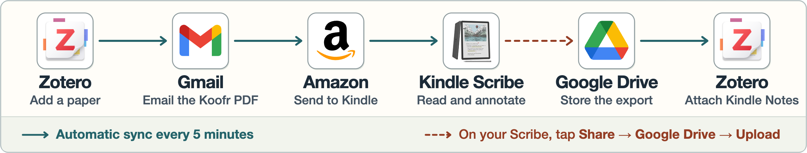

# Kindle Sync

Read Zotero papers on a Kindle Scribe and save your handwritten notes back to the same Zotero item.

<picture>
  <source media="(max-width: 600px)" srcset="docs/assets/kindle-workflow-mobile.webp">
  
</picture>

## Use with an agent

**Docker Compose is the recommended way to deploy Kindle Sync.** Paste this prompt into an agent with terminal access to the machine that will run it.

```text
Clone https://github.com/jialuohu/kindle-sync.git and deploy Kindle Sync on this
machine with Docker Compose. Follow .agents/skills/kindle-sync-deploy/SKILL.md.
Walk me through sign-in, local credential setup, and any steps on my Kindle.
Verify the startup sync and the next scheduled sync. Report papers sent, notes
saved, and any errors.
```

After setup, tell your agent **“Sync my Kindle.”** It sends new papers to your Kindle and brings annotated PDFs from Google Drive back into Zotero. [Deployment skill](.agents/skills/kindle-sync-deploy/SKILL.md) · [Sync skill](.agents/skills/kindle-sync/SKILL.md)

## Everyday use

1. **Add a paper in Zotero.** Every five minutes, Kindle Sync checks your reading collection and its subcollections. It fetches each new paper’s PDF from Koofr WebDAV and emails it to your Kindle.
2. **Annotate it on your Scribe.** When you're ready, tap **Share → Google Drive → Upload**.
3. **Open Kindle Notes in Zotero.** After the next sync, the original item holds your latest annotated PDF alongside the source PDF.

Papers already in the collection at setup stay unsent until you ask. For example, tell your agent “Send the unsent papers in ReadLater.”

## Guides

- [Docker Compose setup and upgrades](docs/docker.md) or [native Linux setup](docs/setup.md)
- [Kindle filenames](docs/setup.md#kindle-filenames) and [which exports return to Zotero](docs/setup.md#which-exports-return-to-zotero)
- [Open Kindle Notes by default in Zotero](zotero-plugin/README.md)
